# 💬 Awesome Live Chat & Conversational Messaging 🚀

> 🎯 A comprehensive, SEO-optimized directory and curated collection of top **Live Chat Software**, **Conversational Messaging Platforms**, **Website Visitor Tracking Tools**, and **Self-Hosted Open-Source Customer Support Solutions**.

  
  
  
  
  

---

  <a href="#-sector-overview--market-dynamics">📈 Sector Overview</a> •
  <a href="#-key-selection-criteria--features">🔍 Key Features</a> •
  <a href="#-saas--hosted-platforms">💼 SaaS Platforms</a> •
  <a href="#-open-source-software">🔓 Open-Source Solutions</a> •
  <a href="#-star-history">⭐ Star History</a> •
  <a href="#-support--sponsor">💖 Support</a> •
  <a href="#-contributing">🤝 Contributing</a>

---

## 📈 Sector Overview & Market Dynamics

The global **Live Chat Software** and **Conversational Messaging** market is estimated between **$1.1 billion and $3.5 billion**, expanding past **$15 billion** when factoring in the broader ecosystem of **Conversational AI**, sales enablement bots, and multi-channel customer engagement suites, compounding at an annual growth rate (CAGR) of **12% to 24%**. 

The sector exhibits **moderate fragmentation**: established cloud enterprise giants (such as Zendesk, Salesforce Service Cloud, and Zoho) command significant market share in unified omni-channel customer service, while fast-growing category leaders (like Freshworks, Intercom, and Gorgias) spearhead AI-driven automated resolution agents. Simultaneously, a thriving landscape of privacy-focused, self-hosted open-source software (such as Chatwoot, Rocket.Chat, and Mattermost) captures rapid adoption among developers, security-conscious enterprises, and organizations seeking full data sovereignty.

---

## 🔍 Key Selection Criteria & Features

When evaluating conversational messaging and live chat software, teams typically consider:
* ⚡ **Real-Time Live Chat Widgets**: Lightweight, responsive SDKs for web, React, Vue, iOS, and Android applications.
* 🤖 **AI Chatbots & Automated Resolutions**: Generative AI assistants (e.g., Fin, Lyro, Freddy AI) resolving tier-1 inquiries autonomously.
* 👁️ **Website Visitor Tracking & Analytics**: Real-time visitor activity monitoring, page paths, IP geolocation, and referral source detection.
* 📬 **Unified Omnichannel Shared Inbox**: Aggregating live web chat, WhatsApp, Facebook Messenger, SMS, and email into a single triage feed.
* 🛡️ **Data Privacy & Self-Hosting**: GDPR/HIPAA compliance options with full on-premise or private cloud deployment control.

---

## 💼 SaaS / Hosted Platforms

*Ranked by company scale (Valuation / Estimated Revenue) in descending order:*

| 🏢 Platform | 📊 Company Scale (Valuation / Revenue) | 🏷️ Starting Pricing (Paid) | 🎁 Free Tier Limits / Free Trial | 📝 Description |
| :--- | :--- | :--- | :--- | :--- |
| **[Zoho SalesIQ](https://www.zoho.com/salesiq/)** | 🏆 ~$13B - $15B valuation (~$1.4B+ annual revenue) | $7/operator/month (billed annually) or $10/operator/month (billed monthly) for Basic | **Free Forever**: Up to 3 operators, 10,000 tracked visitors/month, 100 chat sessions/month, 1 brand (no bots) | Comprehensive live chat, visitor tracking, and customer engagement platform for web and mobile apps. |
| **[Zendesk Chat](https://www.zendesk.com/service/messaging/)** | 🏢 $10.2B acquisition valuation (~$1.7B+ annual revenue) | $55/agent/month (billed annually) or $69/agent/month (billed monthly) for Suite Team | **14-day free trial**: Full access to Zendesk Suite Team features with up to 5 agent seats | Enterprise-grade omnichannel customer support, live chat ticketing, routing, and messaging suite. |
| **[Freshchat](https://www.freshworks.com/live-chat/)** | 📈 ~$3.4B market cap (~$840M+ annual revenue) | $19/agent/month (billed annually) or $23/agent/month (billed monthly) for Growth | **Free Forever**: Up to 10 agents, web/mobile chat widget, shared inbox, email channel | Modern conversational messaging software across web, mobile, WhatsApp, and social channels. |
| **[Drift](https://www.drift.com/)** | 💼 $1B+ peak valuation / Salesloft subsidiary (~$150M+ ARR) | $2,500/month (billed annually) for Premium plan | **14-day free trial**: Available upon request/demo for qualified enterprise evaluations | Conversational marketing and B2B revenue acceleration platform with automated meeting scheduling. |
| **[Intercom](https://www.intercom.com/)** | 🦄 $1.3B peak valuation (~$400M ARR) | $29/seat/month (billed annually) or $39/seat/month (billed monthly) for Essential | **14-day free trial**: Full access to Essential features with no credit card required | AI-first customer service platform featuring the Fin AI agent, shared inbox, proactive messaging, and live chat. |
| **[Gorgias](https://www.gorgias.com/)** | 🛍️ ~$1.0B valuation (~$70M - $100M ARR) | $10/month (billed monthly) for Starter plan | **7-day free trial**: Includes up to 50 tickets and full feature access, no credit card required | Dedicated e-commerce helpdesk and conversational support built natively for Shopify, BigCommerce, and Magento. |
| **[LiveChat](https://www.livechat.com/)** | 💬 ~$280M - $300M market cap / Text S.A. (~$89.5M ARR) | $19/agent/month (billed annually) or $25/agent/month (billed monthly) for Starter | **14-day free trial**: Full access to Team plan features with unlimited chats, no credit card required | Full-featured live chat customer service platform with real-time visitor tracking and rich messaging tools. |
| **[Tidio](https://www.tidio.com/)** | ⚡ ~$100M valuation (~$48M ARR) | $24.17/month (billed annually) or $29/month (billed monthly) for Starter | **Free Forever**: Up to 10 agent seats, 50 handled conversations/month, ticketing, and live chat | Customer service software combining real-time live chat with Lyro AI automated conversation agents. |
| **[tawk.to](https://www.tawk.to/)** | 🌐 ~$17M - $23M annual revenue (Bootstrapped) | $0/month (100% Free; optional $19/mo branding removal or $1/hr human chat agents) | **Free Forever**: 100% free with unlimited agents, unlimited chats, visitor tracking, and ticketing | Completely free live chat application designed to monitor and chat with website visitors seamlessly. |
| **[Olark](https://www.olark.com/)** | 👥 ~$7M annual revenue (Bootstrapped) | $29/agent/month (billed monthly) or $23/agent/month (billed annually) | **Free Forever**: 1 agent seat, 20 chats per month limit (or 14-day full feature trial) | Simple, intuitive live chat tool for customer support, lead capture, real-time typing insights, and visitor analytics. |
| **[Crisp](https://crisp.chat/)** | 🎯 ~$3M - $5M annual revenue (Bootstrapped) | $45/workspace/month (includes up to 4 agent seats) for Mini | **Free Forever**: Up to 2 agent seats, basic live chat widget, contact form, and shared inbox | All-in-one multichannel messaging platform for customer support, co-browsing, live chat, and CRM. |

---

## 🔓 Open-Source Software

*Ranked by GitHub Stars_Count in descending order:*

| 📦 Repository | ⭐ Popularity | 📜 Description |
| :--- | :--- | :--- |
| **[Rocket.Chat](https://github.com/RocketChat/Rocket.Chat)** |  | Secure, open-source communication platform with live chat widgets, omnichannel inbox, voice, and video messaging. |
| **[Chatwoot](https://github.com/chatwoot/chatwoot)** |  | Open-source customer engagement suite and live chat alternative to Intercom, Zendesk, and Drift. |
| **[Mattermost](https://github.com/mattermost/mattermost)** |  | Open-source platform for secure collaboration, developer messaging, and workflow orchestration. |
| **[Zulip](https://github.com/zulip/zulip)** |  | Powerful open-source team chat with unique topic-based threading for organized conversational flows. |
| **[Rasa](https://github.com/RasaHQ/rasa)** |  | Open-source conversational AI framework for building contextual AI assistants, chatbots, and voice channels. |
| **[Botpress](https://github.com/botpress/botpress)** |  | Open-source developer stack and hub to build, deploy, and connect next-generation GPT/LLM conversational agents. |
| **[Tinode](https://github.com/tinode/chat)** |  | Open-source instant messaging server written in Go with web, iOS, Android SDKs, and chatbot integration. |
| **[Matrix Synapse](https://github.com/matrix-org/synapse)** |  | Reference homeserver implementation for Matrix, the open standard for decentralized, secure messaging. |
| **[Papercups](https://github.com/papercups-io/papercups)** |  | Open-source live customer chat widget and shared inbox written in Elixir, built as an Intercom alternative. |
| **[FreeScout](https://github.com/freescout-help-desk/freescout)** |  | Self-hosted open-source help desk and shared mailbox application with live chat and omnichannel modules. |
| **[Live Helper Chat](https://github.com/LiveHelperChat/livehelperchat)** |  | Self-hosted live support chat with web & mobile apps, voice/video/screenshare, bot builder, and multi-channel routing. |

---

## 📊 Star History

---

## 💖 Support & Sponsor

Thank you for visiting and using this curated resource! If you find this repository valuable, please consider supporting the project:

- ⭐ **Star this repository** to help others discover it.
- 🍴 **Fork and contribute** tools, libraries, and corrections.
- 📢 **Share with your colleagues** on Twitter, LinkedIn, Reddit, or developer forums.
- ☕ **Buy me a coffee & support ongoing maintenance:** Visit the [GitHub Sponsors Dashboard](https://github.com/sponsors/ishandutta2007) to become a backer or sponsor.

Your support helps keep this curated list up to date and comprehensive! 🚀

---

## 🤝 Contributing

Contributions are always welcome! 

1. Fork the Project 🍴
2. Create your Feature Branch (`git checkout -b feature/NewTool`) 🌿
3. Commit your Changes (`git commit -m 'Add NewTool'`) 💾
4. Push to the Branch (`git push origin feature/NewTool`) 🚀
5. Open a Pull Request 📩

---

Made with ❤️ by [Ishan Dutta](https://github.com/ishandutta2007) and contributors.

